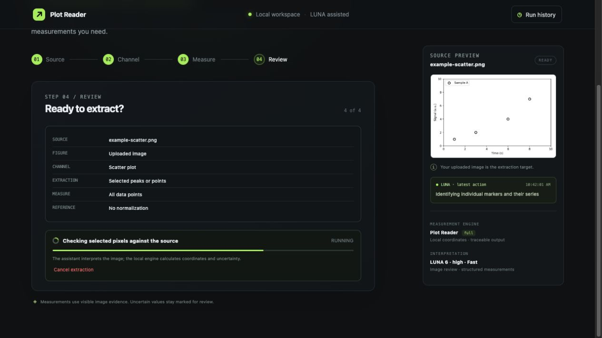
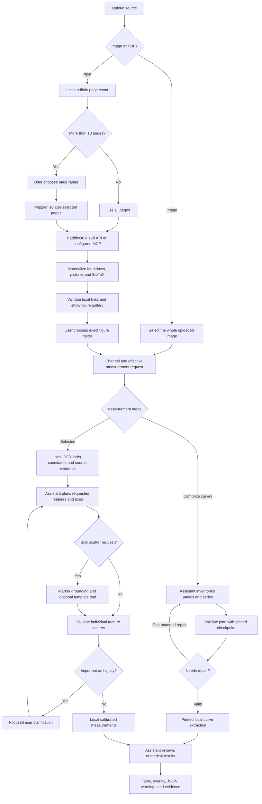
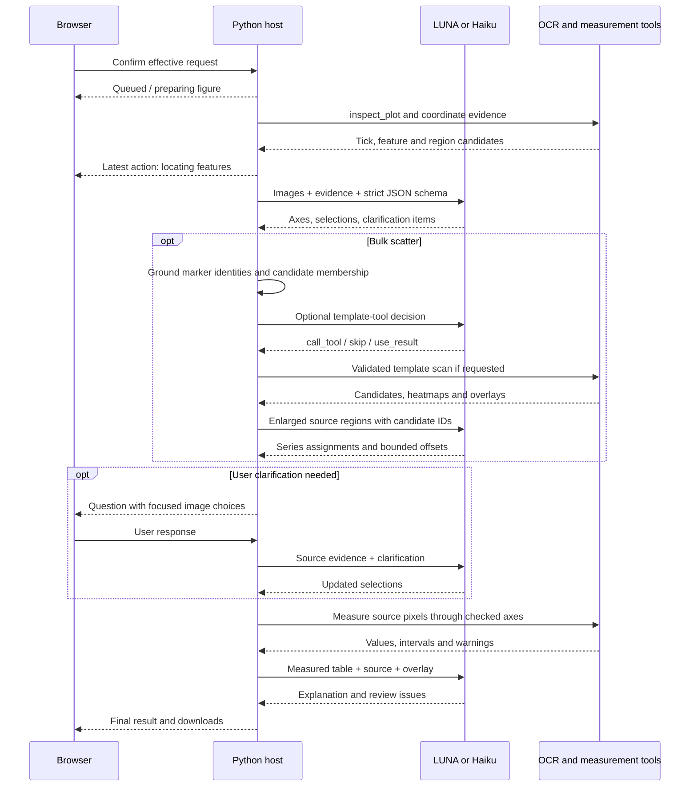
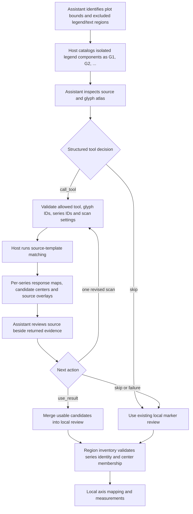

# plot_reader_agent

A local browser application that turns scientific plot images and PDF figures into measured tables, annotated overlays, and a record of the evidence used for each measurement.

The visual assistant interprets the figure and chooses bounded local tools. Python measures source pixels, calibrates axes, validates coordinates, and writes the results. You can run the same workflow with **Codex / LUNA 6 · high · Fast** or **Claude Code / Haiku 5.5 · medium**.

## Contents

- [What it does](#what-it-does)
- [Start by handing the clone to an agent](#start-by-handing-the-clone-to-an-agent)
- [Prerequisites](#prerequisites)
- [Install and run manually](#install-and-run-manually)
- [Enable PDF figure discovery](#enable-pdf-figure-discovery)
- [Use the browser](#use-the-browser)
- [Workflow progress scheme](#workflow-progress-scheme)
- [Scatter template tool calling](#scatter-template-tool-calling)
- [Toolkit and calling contracts](#toolkit-and-calling-contracts)
- [Models and runtime boundaries](#models-and-runtime-boundaries)
- [Outputs and audit trail](#outputs-and-audit-trail)
- [CLI and MCP interfaces](#cli-and-mcp-interfaces)
- [Configuration](#configuration)
- [Tests and verification](#tests-and-verification)
- [Troubleshooting](#troubleshooting)
- [Repository layout](#repository-layout)

## What it does

- Accepts PNG, JPEG, and WebP images. Uploading an image selects the whole image and advances directly to measurement setup.
- Finds and isolates pictures in PDFs through PaddleOCR-VL-1.6, then lets you select a figure by its preview and caption. For PDFs longer than 10 pages, you choose a page range before OCR starts.
- Handles scatter markers, markers with fitted lines, line plots, NMR, IR, Raman, UV–Vis, and other Cartesian plots whose axes are visible.
- Measures selected features or values at specified x positions. An experimental complete-curve mode samples visible series using a pinned local engine.
- Provides defaults when the feature description is blank, including “All data points” for scatter plots.
- Shows the optional NMR nucleus control only for NMR.
- Displays the latest assistant/workflow action in a compact box beside the source figure.
- Preserves uncertain or unresolved measurements, independent axis checks, numerical uncertainty, and the source-pixel locations used to calculate the table.
- Supports explicit point corrections after a selected-measurement run and saves them as a separate result.

Template response peaks are proposals to inspect. They are not probability estimates or a guarantee that every plotted point has been found. Complete-curve extraction remains experimental, especially for crossings, clipping, and indistinguishable overlapping series.

## Start by handing the clone to an agent

The shortest setup path is to clone the repository and open a coding agent in that directory. The assistant used to install the project and the assistant used for plot inference are separate choices; the commands below select both explicitly.

```bash
git clone https://github.com/Jingdan-Chen/plot_reader_agent.git
cd plot_reader_agent
```

### With Codex

Start Codex in the cloned folder:

```bash
codex
```

Paste this instruction:

> Read README.md and AGENTS.md. Install and run this application locally with the Codex inference backend. Use gpt-6-luna, high reasoning effort, and the priority/Fast service tier exactly as configured. Check Python, uv, Tesseract, Poppler, Codex CLI compatibility and sign-in. Run `python3 scripts/setup.py --agent codex --smoke-test`, fix installation problems, and run the release tests. The smoke test makes one real inference request with a generated image. Start `uv run plot-reader web --agent codex`, keep its process running, and give me the localhost URL printed by the server. For PDF input, explain how to provide PADDLEOCR_API_TOKEN through the local environment; never ask me to paste a token into a repository file or chat. Do not silently substitute another model. If account authentication requires my action, give me the exact sign-in step and resume after I complete it.

The installation agent may use its own chosen reasoning settings. Every plot inference call made by this application uses the LUNA profile above.

### With Claude Code

Use a current Claude Code release. Start the installer agent with the requested model and effort:

```bash
claude --model claude-haiku-5-5 --effort medium
```

Paste this instruction:

> Read README.md and AGENTS.md. Install and run this application locally with the Claude inference backend. Use claude-haiku-5-5 with medium effort for plot inference, with no substitute model. Check Python, uv, Tesseract, Poppler, a current Claude Code CLI and sign-in. Run `python3 scripts/setup.py --agent claude --smoke-test`, fix installation problems, and run the release tests. The smoke test makes one real inference request with a generated image. Start `uv run plot-reader web --agent claude`, keep its process running, and give me the localhost URL printed by the server. For PDF input, explain how to provide PADDLEOCR_API_TOKEN through the local environment; never ask me to paste a token into a repository file or chat. If authentication requires my action, give me the exact sign-in step and resume after I complete it. Do not run the Codex backend for this setup.

The application passes `--model claude-haiku-5-5 --effort medium` on each Claude call. A CLI without the required flags produces an actionable error before inference.

## Prerequisites

The complete browser workflow targets **macOS and Linux**. On Windows, use **WSL2 with Ubuntu** and follow the Linux instructions. The process cancellation and model-worker isolation code uses POSIX process groups; native Windows execution is not currently verified.

| Dependency | Purpose |
| --- | --- |
| Git | Clone the source |
| Python 3.11 or newer | Application and numerical engines |
| uv | Reproducible dependency installation from uv.lock |
| Tesseract | Local text and tick-label evidence |
| Poppler: pdfinfo, pdfseparate, pdfunite, pdftoppm | Count, isolate, and render PDF pages |
| Current Codex CLI **or** Claude Code CLI | Visual inference through your authenticated account |
| A local browser | Access the application at 127.0.0.1 |
| PaddleOCR AI Studio token | Required only for PDF figure discovery with the default API backend |

Model access, usage limits, and any applicable charges belong to the account signed in to the chosen inference CLI. Installing the application does not grant model access.

### macOS system tools

If Homebrew is installed:

```bash
brew install uv tesseract poppler
```

If Python is not already installed, install a supported Python version through your normal package manager or let uv manage the interpreter when synchronizing the project.

### Ubuntu / Debian / WSL2

```bash
sudo apt-get update
sudo apt-get install -y git python3 python3-venv tesseract-ocr poppler-utils
```

Install uv using its [official installation instructions](https://docs.astral.sh/uv/getting-started/installation/), then open a new shell or update PATH as instructed by its installer.

### Install and authenticate the inference CLI

Choose one:

- **Codex:** follow the [official Codex CLI guide](https://developers.openai.com/codex/cli), then run `codex login`. The installed CLI must support the flags used in `plot_reader/luna_runtime.py`, including `--ignore-user-config`, `--strict-config`, `--json`, image attachments, and `--output-schema`.
- **Claude Code:** follow the [official Claude Code setup guide](https://code.claude.com/docs/en/setup), then run `claude auth login`. Use a current release with `--effort`, `--json-schema`, `--restricted`, `--tools`, and `--no-session-persistence` support. Old 1.x releases do not provide the required interface.

Run sign-in commands yourself if they open an interactive login flow. Neither provider's account credentials should be copied into this repository.

## Install and run manually

From the clone:

```bash
uv sync --extra test
```

Check everything before opening the browser:

```bash
uv run python scripts/doctor.py --agent codex
# Or:
uv run python scripts/doctor.py --agent claude
```

The doctor checks Python libraries, system executables, the selected CLI, bundled PDF scripts, and the SHA-256 manifest of the complete-curve checkpoint. It reports whether the PDF token exists without printing it. A basic doctor run does not call a model.

To verify image input, account access, and structured output with **one real model request**, add `--smoke-test`:

```bash
uv run python scripts/doctor.py --agent codex --smoke-test
# Or:
uv run python scripts/doctor.py --agent claude --smoke-test
```

Start the browser application:

```bash
uv run plot-reader web --agent codex
# Or:
uv run plot-reader web --agent claude
```

The server prints a URL resembling `http://127.0.0.1:8765/?token=...`. Open the **actual URL printed by your process**. Keep that terminal running. The token changes when the server restarts.

The setup wrapper combines dependency installation, checks, an optional real inference test, and startup:

```bash
python3 scripts/setup.py --agent codex --smoke-test --run
# Or:
python3 scripts/setup.py --agent claude --smoke-test --run
```

It installs the project environment through uv. System packages and inference CLIs are checked and reported with guidance; the wrapper does not configure account credentials.

## Enable PDF figure discovery

Image uploads do not need PaddleOCR. PDFs use the bundled `paddleocr-ocr` skill scripts and PaddleOCR-VL-1.6. The default backend submits selected pages to AI Studio, downloads the result, and materializes local Markdown and figure images.

1. Obtain an AI Studio token for the PaddleOCR jobs service.
2. In the terminal that will start the application, set `PADDLEOCR_API_TOKEN` securely. On Bash, for example:

   ```bash
   read -rsp 'PaddleOCR API token: ' PADDLEOCR_API_TOKEN; echo
   export PADDLEOCR_API_TOKEN
   uv run plot-reader web --agent codex
   ```

   Use `--agent claude` for Claude inference. The token entry is hidden and is not part of the command history.
3. Upload a PDF. Up to 10 pages are searched automatically. For more than 10 pages, select an inclusive range first.
4. Choose a picture from the gallery. Its exact extracted raster becomes the measurement target.

Only the chosen PDF page range is submitted when a range is selected. A range can contain more than 10 pages; 10 is the threshold for asking, not a maximum range length. The original upload and previous extraction runs are retained.

`PADDLEOCR_BACKEND=mcp` is available for users who already have a callable `paddleocr_vl` stdio server configured in `$CODEX_HOME/config.toml`. The request uses detailed output with returned images and then the bundled materializer. This optional configuration also works when Claude handles plot inference; the OCR connector configuration remains separate. The application does not silently switch between API and MCP.

A user-installed `~/.codex/skills/paddleocr-ocr` is used when present; otherwise the copy bundled in this repository is used. `PADDLEOCR_SKILL_DIR` can select an explicit copy. The bundled copy includes a source-hash record in `provenance.json`.

Failures preserve the source and prior runs. A manual retry waits at least 60 seconds after a backend failure, and a page selection is limited to three failed backend attempts. Selecting an already completed identical range reuses its gallery. Fix the underlying problem before trying again; do not edit retry records to bypass the limit.

PDF outputs include `benchmark.txt`, `md/`, `pictures/`, and `bibtex/citation.bib`. The gallery validates Markdown and HTML image references and excludes layout visualizations that are not document pictures. Citation enrichment is best effort; inspect missing-field warnings and verify the citation against the source paper, especially for selected-page excerpts.

## Use the browser

1. **Source:** upload an image, or select an extracted picture from a PDF.
2. **Channel:** choose Spectroscopy, Normal plot, or Others. NMR nucleus is optional and appears only for NMR.
3. **Measure:** choose selected peaks/points or experimental complete curves. Describe a subset, enter x positions, or leave the description blank to use the displayed default.
4. **Review:** inspect the effective request and start extraction. The latest-action box reports short operations as they occur.
5. **Results:** inspect the table, source overlay, uncertainties, warnings, and unresolved rows before exporting. Respond to a focused clarification when the visible evidence is insufficient.

### Defaults for blank feature descriptions

| Channel / style | Selected-feature default |
| --- | --- |
| Scatter plot | All data points |
| Markers with fitted lines | All data points in every marker series |
| Line plot | All visible peaks and turning points across all data series |
| NMR | All visible NMR peaks |
| IR | All visible absorption bands |
| Raman | All visible Raman peaks |
| UV–Vis | All visible absorption peaks |
| Other spectrum | All visible spectral peaks and bands |
| Other Cartesian plot | All visible measurable features across all data series |
| Others | All visible measurable features |

In complete-curve mode, the default is all visible traces/series. If you enter specific x positions and leave the feature description blank, the request is limited to all visible series **at those positions**. Your own feature description overrides the default. The review screen shows the effective request, and the backend also resolves blank requests.

### Latest-action box

The small source-side box displays operations such as:

- Identifying plot bounds and legend exclusions
- Deciding whether a scatter-template scan will help
- Running source-template scatter scan
- Checking selected pixels against the source
- Reviewing measured results and writing the explanation

These are brief workflow actions, not a transcript of private model reasoning. Meaningful actions are persisted in the job record. Server-sent events update the UI promptly; status polling restores the current action after a reconnect. The box also records completion, failure, cancellation, and requests for user clarification.



## Workflow progress scheme

The diagrams describe the implemented calling paths. Solid paths are host-controlled; the assistant chooses semantic interpretations and the bounded template-tool action.



### Selected-feature progress



## Scatter template tool calling

Repeated marker shapes can provide a useful image-space prior when fitted lines, text, and marker strokes overlap. The assistant does not draw an arbitrary convolution kernel. It selects complete marker glyphs already visible in the source legend.



The internal tool is named **`scan_scatter_templates`**. Its controlled interface accepts:

- A list of supported `{series_id, glyph_id}` pairs.
- `size_search`: one of the bounded search modes exposed by the tool schema.
- `sensitivity`: one of the bounded sensitivity modes exposed by the tool schema.

The host rejects unknown tools, external source paths, invented IDs, repeated template pairs, and unsupported parameter values. A decision loop allows **at most four model decisions and two actual scans**. The second scan is for a justified adjustment. After a usable result, the assistant can accept that evidence with `use_result`; this does not accept any measurement point by itself.

Source-derived response maps and overlays are returned to the assistant as images. Peak selection, nonmaximum suppression, exclusions, and candidate checks remain local. Candidate centers from this tool are fixed in the later binding stage. The assistant assigns series identities against the unannotated source; it cannot silently move a bright response peak to a more convenient position.

### Matching details

The host converts the original grayscale glyph to ink intensity, resizes it within a narrow scale bank, and pads its background. OpenCV normalized cross-correlation (`TM_CCOEFF_NORMED`) produces a response field. A separate correlation with the glyph's ink support measures coverage. A competing bank of straight-line kernels, tested every 15 degrees at two thicknesses, estimates whether a line alone explains a bright location.

A candidate must pass correlation, at least 50% ink coverage, and a margin over that line-only response. Local maxima are suppressed by size, merged across scales, and restricted to the plot rectangle outside the excluded legend/text regions. A bounded 2D quadratic fit refines stable peaks by at most 0.75 pixel; flat, saddle, edge or unstable fits keep the integral response location. Centers use the glyph bounding-box center rather than its ink centroid, which avoids a systematic bias for hollow asymmetric shapes such as triangles.

| Preset | Values |
| --- | --- |
| `legend_size` | scales 0.85, 1.0, 1.15 relative to the legend glyph |
| `smaller_markers` | scales 0.55, 0.65, 0.75, 0.85, 1.0 |
| `balanced` | correlation ≥0.57; margin over line response ≥0.06 |
| `conservative` | correlation ≥0.64; margin over line response ≥0.08 |

An illustrative assistant decision is below. IDs must come from the current host-provided catalog; the model cannot invent them.

```json
{
  "action": "call_tool",
  "tool_name": "scan_scatter_templates",
  "arguments": {
    "templates": [{"series_id": "S0", "glyph_id": "G1"}],
    "size_search": "legend_size",
    "sensitivity": "balanced"
  },
  "reason": "The isolated legend glyph and plotted markers share a complete, repeated shape."
}
```

The tool is best suited to repeated, dark marker glyphs with an isolated legend sample and roughly consistent size. Missing glyphs, unsupported series, model/validation errors, and unsuitable images retain the existing local-review path. Set `PLOT_READER_SCATTER_TEMPLATES=off` to disable the optional evidence path.

## Toolkit and calling contracts

| Stage / tool | Caller and inputs | Returned evidence / behavior |
| --- | --- | --- |
| Source upload and target selection | Browser → local HTTP routes | Validated source ID; image target or selected PDF figure/run ID |
| PDF page selection | Host → Poppler subprocesses | Local page count and selected-page PDF before OCR |
| PDF figure discovery | Host → bundled PaddleOCR skill | Markdown, local pictures, BibTeX, timings, warnings |
| `inspect_plot` | Host → local core | Source dimensions, OCR boxes, ticks, bounds, feature candidates |
| `refine_region` | CLI/MCP caller → local core | Enlarged original-image region and refined evidence |
| Coordinate evidence / focused crops | Host → local image helpers | Grids and enlarged regions in original source coordinates |
| Structured inference | Host → Codex or Claude CLI | Schema-validated semantic decisions; model and effort recorded per call |
| `scan_scatter_templates` | Assistant structured decision → validated host dispatcher | Per-series response images, source overlays, fixed center candidates |
| Marker region inventory | Host → assistant with enlarged local evidence | Candidate IDs, series assignments, verdicts and bounded offsets |
| Axis calibration | Host → local core | Linear/log/reversed mapping with independent checks |
| `measure_plot` / selected measurement | Host → local engine | Numerical coordinates, normalized heights when requested, uncertainty |
| Complete-plan validation | Host → pinned immutable checkpoint | Explicit validation errors; at most one model repair |
| Complete-curve extraction | Host → pinned immutable checkpoint | Sampled curves, features, queries and evidence |
| Explanation / review | Host → assistant with measured results | Human-readable explanation and review issues |
| Explicit point correction | User → host → local remeasurement | New saved run; no new model inference is required |
| Job watching | Browser → SSE plus status polling | Progress actions, current clarification, completion and reconnect recovery |

The ordinary inference worker has no general shell, file-editing, browser, or external MCP tools. The scatter-tool protocol is an application-owned JSON decision loop: Python validates and executes the allowed request, then sends the evidence into another model call. The same protocol works with both inference providers.

## Models and runtime boundaries

| Backend | Exact configured model | Effort | Speed setting |
| --- | --- | --- | --- |
| `codex` | `gpt-6-luna` | `high` | `service_tier=priority` / Fast |
| `claude` | `claude-haiku-5-5` | `medium` | Standard Claude CLI service behavior |

These settings are explicit per call. The application does not silently choose another model if one is unavailable. The setup agent should report an access or CLI compatibility problem and help resolve it.

- Codex uses JSON events, attached images, `--output-schema`, an isolated work directory, ignored user configuration, and a read-only sandbox. General tools and skill discovery are disabled for inference workers.
- Claude uses `--input-format stream-json`, base64 PNG image blocks, `--output-format stream-json`, `--json-schema`, `--restricted`, `--tools ''`, an empty explicit MCP configuration, and no session persistence. It extracts the CLI's `structured_output` and validates it locally.
- Each inference call saves `response.schema.json`, `response.json` on success, and an `inference.json` profile record.
- Calls are bounded by a timeout and canceled as a process group. No model credentials are placed in command arguments.
- Plain CLI logs and model reasoning are not copied into the latest-action box.

The Claude model ID and medium-effort support are described in the [official Haiku 5.5 model page](https://platform.claude.com/docs/en/models/haiku-5-5/overview) and [Claude CLI reference](https://code.claude.com/docs/en/cli-reference). For Codex automation, see [official non-interactive mode documentation](https://developers.openai.com/codex/noninteractive).

### Local and remote processing

The HTTP server binds to `127.0.0.1` and checks a session token on protected routes. Uploaded sources and generated outputs are saved locally. Source images and evidence images are transmitted to the selected inference provider through its CLI. PDF pages are also transmitted to AI Studio when PaddleOCR discovery is used. This is a local application with remote inference, not an offline-only tool.

Do not expose the local server to a public network without a separate deployment and authentication design. The published repository contains source code, packaged runtime assets, and tests; local uploads, result histories, credentials, and development campaign records are excluded.

## Outputs and audit trail

The default data directory is `artifacts/browser/`, configurable through `PLOT_READER_WEB_DATA`.

```text
artifacts/browser/
  sources/<source-id>/
    source.json                 # upload metadata
    source.<image-or-pdf>       # original upload
    target.json                 # selected image or exact PDF figure/run
    figure-intake.json          # current OCR status pointer
    figure-intake/<run-id>/
      intake.json
      figures.json
      pages-<start>-<end>.pdf    # when a subset is needed
      runs/<timestamped-run>/
        benchmark.txt
        md/
        pictures/
        bibtex/citation.bib
  jobs/<job-id>/
    job.json                    # durable status and latest action
    request.json                # effective request and selected target
    source-image.png            # exact measurement image
    events.jsonl                # progress/evidence events
    worker/<stage>/
      response.schema.json
      response.json
      inference.json
    ...                         # inspections, plans, review evidence, overlays
```

The browser offers CSV, JSON, and overlay downloads. Intermediate filenames vary by the selected path; scatter runs can include marker layouts, candidate inventories, glyph atlases, response maps and `tool-trace.json`. Complete extraction retains the plan and local validation/extraction outputs.

Axis calibration requires observed anchors and independent checks. Unsupported axes can remain uncalibrated. Measurements retain source coordinates and uncertainty; warnings or individually unresolved points should be reviewed rather than replaced with invented values.

A server restart preserves saved files and marks previously active work interrupted. A completed result can be opened through Run history. Restarting an extraction is explicit; the server does not automatically resume and spend additional inference usage after a restart.

## CLI and MCP interfaces

The browser is the primary guided interface. The numerical toolkit can also be called directly:

```bash
uv run plot-reader version
uv run plot-reader inspect /absolute/path/to/plot.png --full
uv run plot-reader refine <session-id> '[100,100,500,400]'
```

`measure` accepts explicit axis and selection JSON. Inspect its arguments with:

```bash
uv run plot-reader measure --help
```

The deterministic numerical engine supports `--profile full`, `--profile fast`, and `--profile experimental`. These **measurement profiles** are independent of the inference provider's Fast/priority setting. The browser selected-feature path uses the full engine; complete curves use the packaged pinned checkpoint.

To expose local numerical tools over stdio MCP:

```bash
uv run plot-reader-mcp
```

An MCP client can launch `uv` in the clone with arguments `run plot-reader-mcp`. The service exposes plot inspection, region refinement, and measurement tools; it does not grant the model unrestricted shell access. Use absolute source paths and keep inspection/session IDs from the tool responses.

## Configuration

| Variable / option | Default | Purpose |
| --- | --- | --- |
| `--agent codex` / `--agent claude` | `codex` | Choose the inference provider when starting the browser |
| `PLOT_READER_AGENT` | `codex` | Environment alternative to the launcher option |
| `PLOT_READER_WEB_PORT` | `8765` | Local HTTP port |
| `PLOT_READER_WEB_DATA` | repository `artifacts/browser` | Saved sources and jobs |
| `PLOT_READER_OPEN_BROWSER` | unset | Set to `1` to open the printed URL automatically |
| `PLOT_READER_SESSION_ROOT` | local temporary sessions directory | Numerical engine session records |
| `PLOT_READER_PROFILE` | `full` | Direct CLI/MCP measurement profile |
| `PLOT_READER_SCATTER_TEMPLATES` | `auto` | Set `off` to disable the optional template tool |
| `PADDLEOCR_BACKEND` | `api` | `api` or explicitly configured `mcp` |
| `PADDLEOCR_API_TOKEN` | unset | AI Studio PDF discovery credential |
| `PADDLEOCR_SKILL_DIR` | installed skill, otherwise bundled copy | Explicit PDF skill location |
| `PADDLEOCR_PYTHON` | existing interpreter with requests | Optional Python override for the skill script |
| `PADDLEOCR_API_URL` | skill's AI Studio jobs endpoint | Optional endpoint override |
| `PADDLEOCR_MODEL` | `PaddleOCR-VL-1.6` | OCR model override |

Examples:

```bash
PLOT_READER_WEB_PORT=8770 uv run plot-reader web --agent codex
PLOT_READER_SCATTER_TEMPLATES=off uv run plot-reader web --agent claude
```

## Tests and verification

From a clean clone:

```bash
uv sync --extra test
uv run pytest -q
node --check plot_reader/browser_ui/app.js
node --test tests/test_browser_watch.cjs
```

Node is needed for JavaScript tests, not for serving the browser assets. Inference CLIs may have their own Node/runtime installation requirements.

The included tests cover coordinate calibration, log/reversed axes, feature/curve extraction, scatter-template dispatch and fallbacks, PDF page-range gating, exact extracted-image selection, source preservation, retry limits, blank-request defaults, provider command/image/JSON contracts, latest-action persistence, and reconnect behavior.

Most tests use generated images and mocked model responses. They do not verify model account access. Use `scripts/doctor.py --smoke-test` for the selected provider's real image/JSON round trip. A successful LUNA run does not establish live Haiku access; run the Claude smoke test on the target account too.

The complete-curve checkpoint lives under `plot_reader/checkpoints/`. Its manifest and every listed source hash are checked before execution. Historical benchmark campaign folders are not required to run this release and are not included in it. This repository does not claim an accuracy percentage from those private development campaigns.

## Troubleshooting

| Symptom | Action |
| --- | --- |
| Local session expired / HTTP 403 | Open the latest URL printed by the running server; a restart creates a new token |
| Port 8765 is occupied | Select another port with PLOT_READER_WEB_PORT |
| Codex flag is unknown | Install a compatible current Codex CLI and rerun the doctor; inspect the exact worker command in the source |
| Claude CLI is too old | Update from the official installer; required flags are checked before inference |
| Model is unavailable | Verify account access to the exact configured model and CLI sign-in; no fallback model is selected |
| Structured response fails validation | Inspect the saved response/schema and retry with clearer source evidence; do not treat invalid output as measurements |
| Tesseract or Poppler missing | Install the system packages in the prerequisite section and rerun doctor |
| PDF discovery says token missing | Set PADDLEOCR_API_TOKEN in the same environment that starts the portal, then restart |
| MCP OCR server is unavailable | Enable/configure paddleocr_vl and start a fresh portal process; do not expect an automatic API fallback |
| No PDF pictures found | Select another relevant page range or upload an image crop directly |
| Points are ambiguous or shifted | Inspect the unannotated source, overlays and uncertainties; use explicit corrections or a higher-resolution source |
| Complete-curve checkpoint integrity error | Restore packaged files from Git and rerun doctor; do not bypass the hash check |
| Stale browser after an update | Reload the latest printed server URL after restarting the application |
| Agent is running inside Claude Code | The inference worker clears the parent CLAUDECODE marker for its separate non-interactive process |

## Repository layout

```text
plot_reader/
  browser.py                 # local HTTP application and job orchestration
  browser_ui/                # browser form, latest-action box and job watcher
  luna_runtime.py            # Codex/LUNA and Claude/Haiku inference adapters
  browser_grounding.py       # marker layout, region inventory and binding
  browser_evidence.py        # source evidence, crops and corrections
  browser_measurement.py     # selected measurement with retained warnings
  scatter_template_tool.py   # bounded model-to-host tool protocol
  scatter_templates.py       # local source-template matching and response maps
  pdf_figures.py             # PDF selection, skill dispatch and gallery indexing
  paddleocr_skill_runner.py  # failure-stage annotation around the bundled client
  core.py / fast/            # deterministic numerical profiles
  complete.py                # experimental complete-plot tools
  checkpoints/               # pinned complete-curve source and hash manifest
  vendor/paddleocr-ocr/       # unchanged packaged skill scripts and provenance
scripts/
  setup.py                   # guided uv install, checks and optional startup
  doctor.py                  # environment checks and optional real inference
  build_release.py           # explicit source-only export for publication
  example_plot.py            # generates a small example scatter image
AGENTS.md                    # setup contract for Codex/Claude installers
pyproject.toml / uv.lock      # reproducible Python environment
README.md                    # setup, workflow schemes and calling contracts
```
